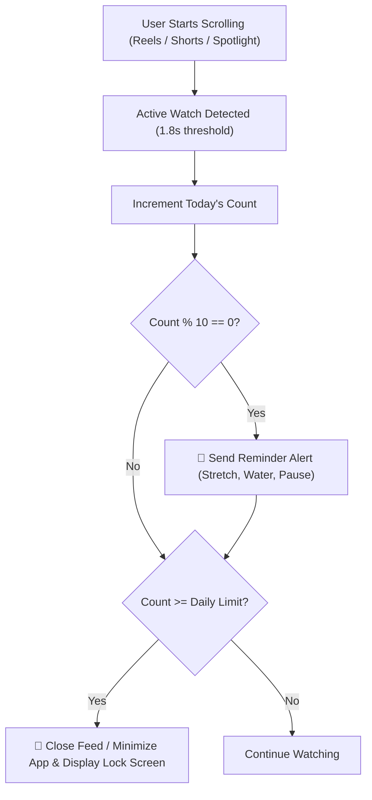

# ReelLimit - Shorts, Reels & Spotlight Focus Guard

A dual-platform digital wellbeing solution that monitors short-form video consumption across **Instagram Reels**, **YouTube Shorts**, and **Snapchat Spotlight**, delivers mindful reminder alerts every 10 videos, and automatically closes the application when your daily watch limit is reached.

---

## Solutions Included

| Platform | Location | Description |
| :--- | :--- | :--- |
| **Browser Extension** | [`extension/`](extension/) | Manifest V3 extension for Chrome, Brave, Edge, and Chromium browsers. Features real-time in-feed floating counters, milestone toasts, notifications, and auto-closing or full-screen lock. |
| **Android Native App** | [`android/`](android/) | Native Kotlin application using Android's `AccessibilityService` to monitor native Instagram, YouTube, and Snapchat apps, trigger haptic reminders, kick to Home screen, and block reopening. |

---

## 🚀 Quickstart: Web Extension (Chrome / Edge / Brave)

You can load and use the extension immediately in your browser:

1. Open your browser and navigate to:
   - **Chrome**: `chrome://extensions`
   - **Brave**: `brave://extensions`
   - **Edge**: `edge://extensions`
2. Enable **Developer mode** (toggle in the top-right corner).
3. Click **Load unpacked** in the top-left corner.
4. Select the folder:
   ```
   c:\Users\KISHOR SRE\Documents\antigravity\cool-bell\extension
   ```
5. Click the ReelLimit puzzle icon in your browser toolbar to pin it.
6. Open [YouTube Shorts](https://www.youtube.com/shorts) or [Instagram Reels](https://www.instagram.com/reels):
   - You will see a sleek floating pill: `Reels: X / 20`.
   - Every 10 reels watched, an alert toast and desktop notification will appear.
   - Once your limit is reached, the tab will close automatically or redirect to the calming blocked screen.

---

## 📱 Quickstart: Android App

1. Open **Android Studio**.
2. Select **Open** and choose the [`android/`](android/) folder.
3. Build and deploy to your phone or emulator.
4. Launch **ReelLimit** and grant the **Accessibility Service** permission.
5. Set your daily limit (e.g. 20 reels).
6. When scrolling in Instagram Reels, YouTube Shorts, or Snapchat Spotlight:
   - Every 10 reels: phone vibrates and displays a milestone notification.
   - Limit reached: app automatically minimizes (`GLOBAL_ACTION_HOME`), locks the screen, and prevents reopening until the daily reset.

---

## Core Features Breakdown



1. **Anti-Skimming Smart Debounce:**
   Only counts a video if the user stays for at least 1.8 seconds. Rapidly swiping past videos does not artificially inflate your watch count.
2. **Milestone Alerts (Every 10 Reels):**
   Delivers a polite, unobtrusive reminder with a suggestion to rest your eyes, stretch, or hydrate.
3. **Strict Limit Enforcement:**
   When the daily threshold is met:
   - **Browser**: Instantly closes the tab or redirects to a full-screen dopamine-reset page equipped with a 4-7-8 breathing exercise.
   - **Android**: Calls `performGlobalAction(GLOBAL_ACTION_HOME)` to immediately minimize the native app and displays `LockOverlayActivity` to block reopening.
4. **Privacy First:**
   100% on-device storage. No analytics, tracking, or network calls.
